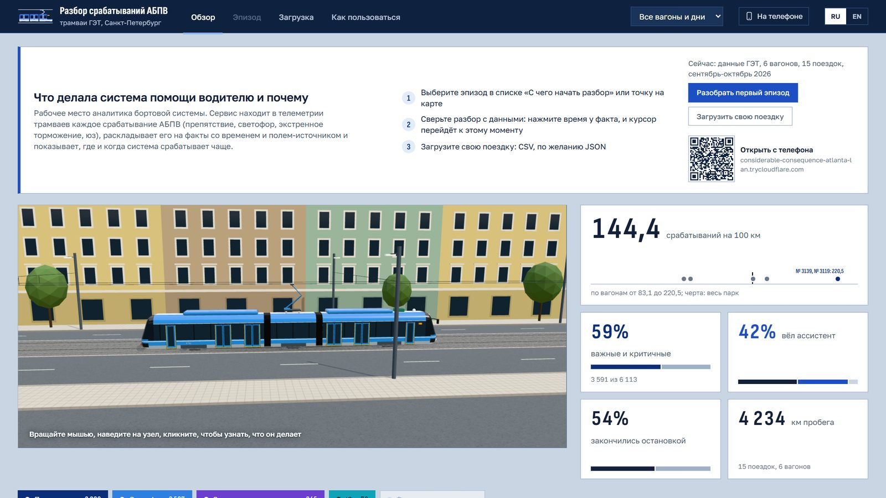
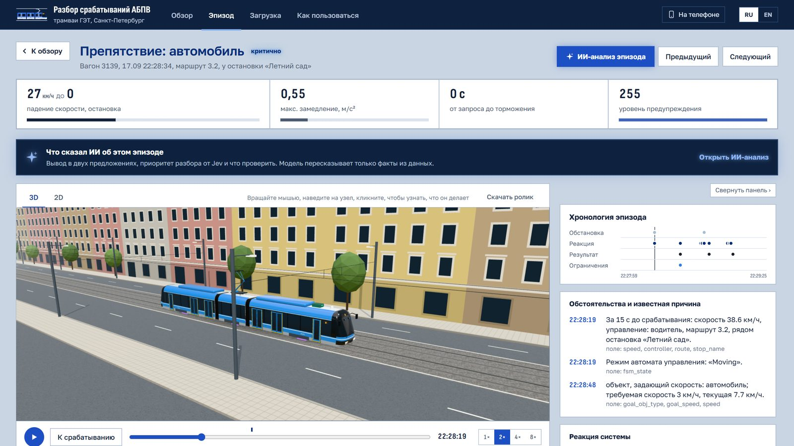
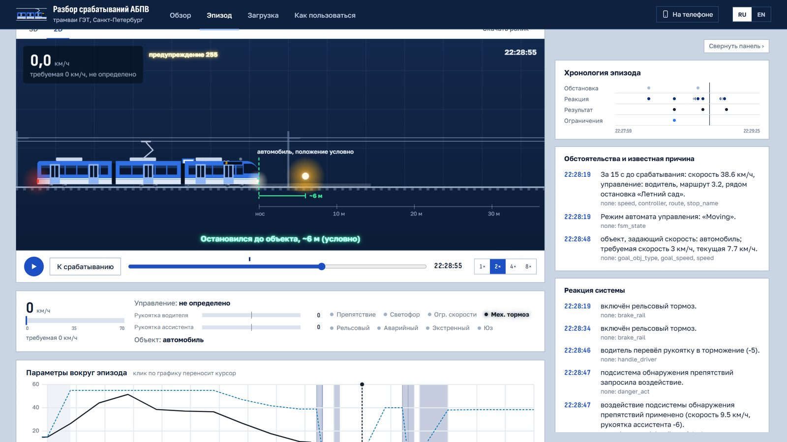
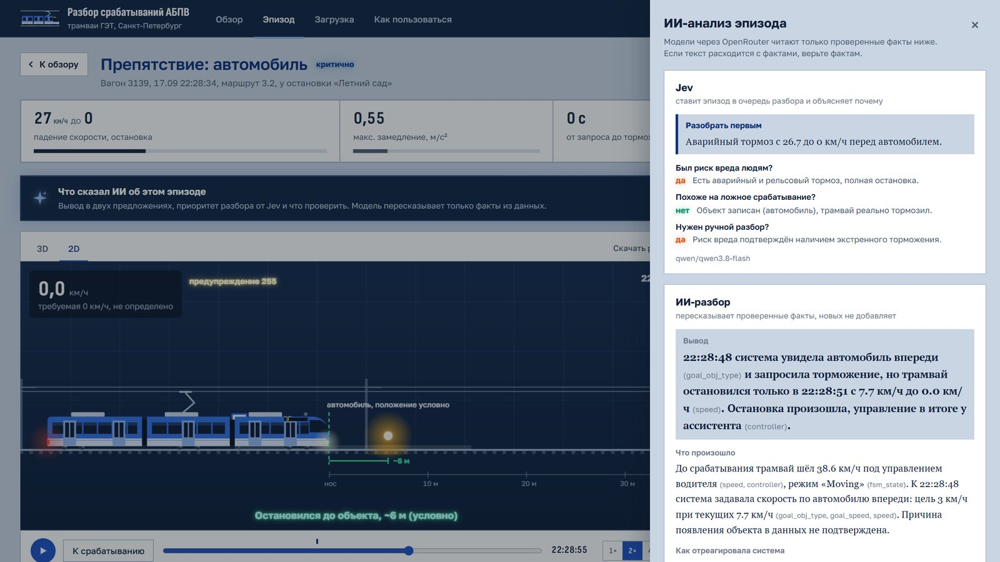
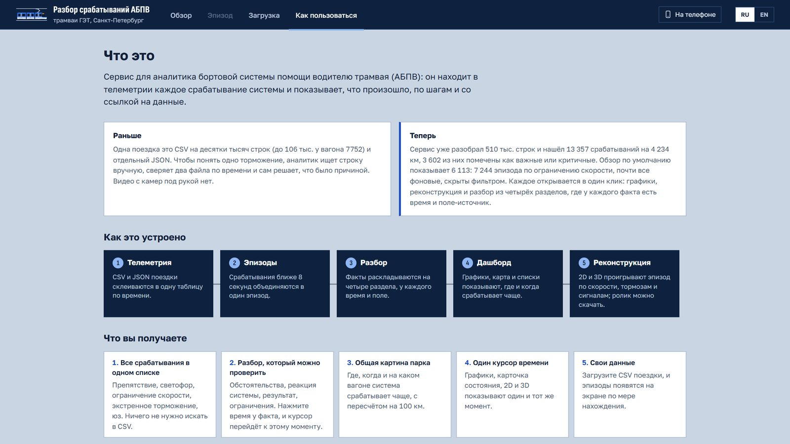
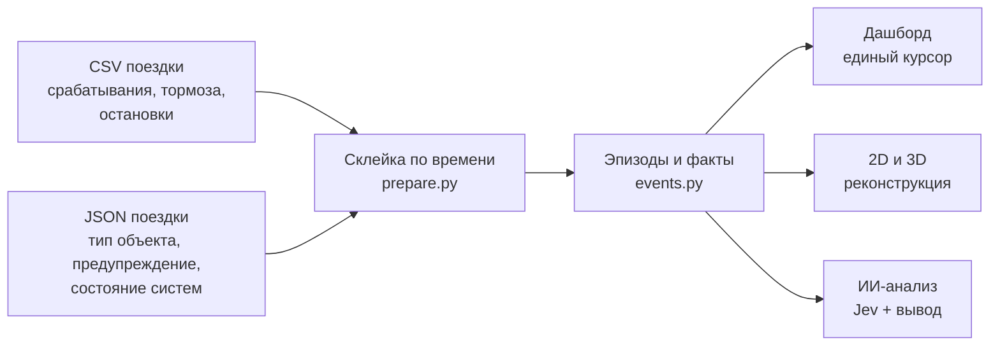

<div align="center">


# Разбор срабатываний АБПВ

**Рабочее место аналитика системы помощи водителю трамвая.**
Находит в телеметрии каждое срабатывание, раскладывает его на проверяемые факты со временем и полем-источником,
показывает эпизод на дашборде с единым временным курсором, в 2D и 3D, и даёт ИИ-вывод, который пересказывает только факты.

Хакатон НТУ «Сириус» × СПб ГУП «Горэлектротранс», октябрь 2026


</div>



## Что это и зачем

Неделя записей одного вагона это около 100 тысяч строк CSV и почти 200 МБ JSON. Чтобы понять одно торможение,
аналитик ищет строку вручную, сверяет два файла по времени и сам решает, что было причиной.

Сервис делает это автоматически на реальных данных ГЭТ:

| | |
|---|---|
| **15 поездок, 6 вагонов** | 510 тыс. точек телеметрии, около 4 234 км |
| **6 113 срабатываний** | без фонового ограничения скорости, 144,4 на 100 км |
| **59%** | важные и критичные: препятствие, рельсовый, аварийный, экстренный тормоз, юз |
| **42%** | срабатываний, когда трамваем управляла автоматика (ассистент) |

Все пять этапов из ТЗ работают: подготовка данных, автоматический разбор, дашборд, 2D- и 3D-реконструкция.

## Как выглядит

<table>
<tr>
<td width="50%"><br><b>Эпизод.</b> Цифры эпизода, 3D-сцена, хронология и факты разбора. Клик по времени факта переносит курсор во всех панелях.</td>
<td width="50%"><br><b>2D-реконструкция.</b> Трамвай едет по записанной скорости; объект стоит на пути; итог «остановился до объекта» или «сигнал снят».</td>
</tr>
<tr>
<td><br><b>ИИ-анализ.</b> Jev ставит приоритет разбора, модель даёт вывод, хронологию и что проверить. Только по фактам.</td>
<td><br><b>Как пользоваться.</b> Сценарии работы, смысл метрик и ограничения данных прямо в продукте.</td>
</tr>
</table>

## Как это работает



**Почему два файла.** В CSV записано, *что* сработало: флаги подсистем по стадиям, тормоза, остановки.
В JSON записано, *почему и в какой обстановке*: по какому объекту система задавала скорость, какое предупреждение
увидел водитель, состояние подсистем и датчиков. В части поездок флаги срабатываний в JSON пустые, а сам JSON покрывает
только первый день, поэтому CSV обязателен, а JSON дополняет его.

**Разбор собирает код, а не модель.** `backend/events.py` группирует срабатывания ближе 8 секунд в эпизод и раскладывает
его на факты по четырём разделам ТЗ: обстоятельства, реакция системы, результат, ограничения. У каждого факта есть
время и поле данных. Причина называется, только если её подтверждает поле, иначе пишем «причина не установлена».

**ИИ только пересказывает.** Через OpenRouter работают две модели:

- **Jev** (`qwen/qwen3.8-flash`) ставит эпизод в очередь разбора: «разобрать первым», «в очереди» или «можно не
  разбирать», с одной фразой почему и ответами да / нет / не знаю на три вопроса: был ли риск вреда людям,
  похоже ли на ложное срабатывание, нужен ли ручной разбор.
- **Разбор** (`deepseek/deepseek-v4.1-flash`) пишет вывод в двух предложениях, хронологию, чего мы не знаем и что проверить.

Модели получают только список проверенных фактов, ответы кешируются в `data/processed/narratives/`.
Один эпизод с разбором стоит меньше $0,002.

## Запуск

Нужны Python 3.12 и Node.js 20+.

```bash
pip install -r requirements.txt
npm --prefix frontend install
```

Данные ГЭТ в репозиторий не входят. Положите выгрузку в `data/raw/new_data/hakathon_new_data/<вагон>/`
(пары `*_move_detailed_<вагон>.csv` и `.jsonseq`) и соберите таблицы:

```bash
python backend/ingest.py
python backend/prepare.py
```

Запустите API и сайт:

```bash
python -m uvicorn api:app --app-dir backend --port 8000
```

```bash
npm --prefix frontend run dev -- --port 5173
```

Дашборд откроется на http://127.0.0.1:5173. Для ИИ-анализа задайте ключ OpenRouter в `.env`
(образец в `.env.example`): без него всё остальное работает, а ИИ-окно покажет кешированные ответы.

### Windows одним кликом

```bash
powershell -ExecutionPolicy Bypass -File launcher/install.ps1
```

Ярлык «Разбор АБПВ» на рабочем столе и в «Пуске» поднимает API и сайт в фоне, открывает окно приложения и значок
в трее: открыть, перезапустить серверы, логи, выйти. Сторож сам поднимает упавший сервер.

### Своя поездка

Вкладка «Загрузка»: перетащите CSV поездки, JSON по желанию. Файл разбирается тем же конвейером на этом же
компьютере, эпизоды появляются на экране по мере нахождения. ИИ при загрузке не вызывается.

## Чего нет в данных

Разбор пишет об этом прямо в каждом эпизоде:

- **Расстояния до объекта нет.** Известно, по какому объекту система задавала скорость, но не как далеко он был.
  Поэтому положение объекта на сцене условное.
- **Время в CSV с точностью до секунды.** Порядок событий внутри одной секунды неизвестен.
- **JSON есть не везде.** В многодневных поездках он покрывает только первый день: там тип объекта и предупреждение
  не записаны.
- **Кадров камер к этим поездкам нет.** Ролики из материалов хакатона относятся к другим дням и показаны как примеры.

## Структура

```
backend/      ingest.py (jsonseq -> parquet), prepare.py (склейка CSV + JSON), events.py (эпизоды и факты), api.py (FastAPI)
frontend/     React + Vite + three.js: обзор, эпизод, 2D/3D, ИИ-окно, загрузка, «Как пользоваться»
launcher/     приложение для Windows: ярлык, трей, сторож, иконка
notebooks/    Colab: признаки и пробная модель прогноза торможения за 10 с
pitch/        презентация защиты и сценарий выступления
docs/         GUIDE.md (тексты инструкции), скриншоты
ML_REPORT.md  что сделано в ML-части, что слабо и что доработать
```

## ML-часть

Ядро продукта это правила и факты, они надёжны и проверяемы. Поверх них:

- **«Необычность»** эпизода внутри своего типа помогает сортировать очередь разбора.
- **Пробная модель** в `notebooks/feature_engineering.ipynb` предсказывает торможение по препятствию за 10 секунд:
  PR-AUC 0,07 против 0,026 у случайного (в 2,7 раза лучше), ROC-AUC 0,76 при разбиении по вагонам.
  Как прогноз пока слабая, в продукт не включена.

Подробно, с планом доработок, в [ML_REPORT.md](ML_REPORT.md).

---

<details>
<summary><b>English summary</b></summary>

**ADAS episode review for Saint Petersburg trams.** The tool scans onboard telemetry (CSV + JSON) from GET trams,
finds every activation of the driver-assistance system, splits each episode into verifiable facts with a timestamp
and a source field, and shows it on a dashboard with a shared time cursor, in 2D and 3D. Two LLMs via OpenRouter only
retell the verified facts: **Jev** sets the review priority, the review model writes a conclusion and what to check.
Real GET data: 15 trips, 6 wagons, ~4,234 km, 6,113 activations. UI in Russian and English.
Run: `pip install -r requirements.txt`, `npm --prefix frontend install`, then the two commands above.
</details>
